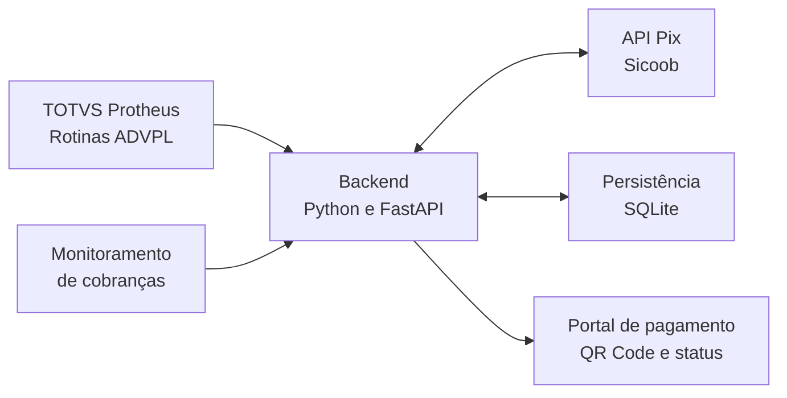

# KM-PIX

### Integração Pix entre TOTVS Protheus e Sicoob

Estudo de caso de desenvolvimento **backend e ADVPL**: uma solução que conecta cobranças Pix ao processo de pedidos de venda no TOTVS Protheus, combinando API, persistência e acompanhamento do pagamento.

**Desenvolvido por [Keven Sena Martins](https://github.com/Keven-Martins)** · Python · FastAPI · ADVPL · SQL · APIs REST

## O problema

Quando o recebimento do pagamento fica separado da rotina do pedido de venda, a operação precisa consultar informações em sistemas diferentes e acompanhar manualmente o andamento da cobrança.

O KM-PIX foi desenvolvido para integrar essa comunicação ao Protheus e centralizar a interação com a API Pix do Sicoob em um serviço backend.

## A solução

- Geração, consulta e cancelamento de cobranças Pix vinculadas ao pedido.
- Apresentação de QR Code e Pix Copia e Cola em um portal de pagamento.
- Acompanhamento do estado da cobrança e conciliação dos recebimentos.
- Persistência de informações para continuidade do processamento.
- Integração com rotinas ADVPL e regras do fluxo comercial e financeiro.

## Arquitetura

As rotinas ADVPL conectam o processo no ERP ao backend. A API organiza a comunicação bancária, a persistência e os retornos utilizados pelo portal e pelas rotinas de integração.

## Minha atuação

Atuei no desenvolvimento do backend Python e da integração com o Protheus em ADVPL, conectando o fluxo de cobranças às regras do pedido de venda. O trabalho envolve compreender o processo empresarial, implementar a comunicação entre sistemas e tratar os diferentes estados e retornos da integração.

## Decisões técnicas

| Desafio | Abordagem desenvolvida |
| --- | --- |
| Solicitações simultâneas para o mesmo pedido | Reserva persistente e controles de concorrência |
| Falhas ou retornos incertos na comunicação | Registro de estado e reconciliação da cobrança |
| Valores financeiros | Validação dos valores recebidos e tratamento de precisão monetária |
| Pedidos de filiais diferentes | Identificação e processamento por filial e pedido |
| Acompanhamento do pagamento | Portal com atualização do estado e processamento de monitoramento |
| Integração com o ERP | Comunicação REST e rotinas ADVPL relacionadas ao fluxo comercial e financeiro |

## Tecnologias

- **Backend:** Python e FastAPI.
- **ERP:** TOTVS Protheus e ADVPL.
- **Dados:** SQL e SQLite.
- **Integração bancária:** APIs REST, OAuth2 e certificados.
- **Portal:** HTML, CSS, JavaScript e templates Jinja2.
- **Versionamento:** Git e GitHub.

## Fluxo ilustrativo

1. Um pedido demonstrativo é selecionado no ERP.
2. A rotina ADVPL solicita a cobrança ao backend.
3. O backend comunica-se com o Sicoob e registra as informações da cobrança.
4. O portal apresenta o QR Code e o estado do pagamento.
5. O acompanhamento atualiza o recebimento e disponibiliza as informações para as rotinas do ERP.

## Sobre esta apresentação

Este repositório reúne a apresentação técnica do projeto para portfólio. O código operacional permanece em repositório privado. Os exemplos são descritivos e não utilizam credenciais, dados reais de clientes ou configurações do ambiente da empresa.

## Contato

Interessado em backend, integrações ou desenvolvimento ADVPL/Protheus?

[Conheça meu perfil](https://github.com/Keven-Martins) · [Contato profissional](mailto:kevenoab2023@gmail.com)
